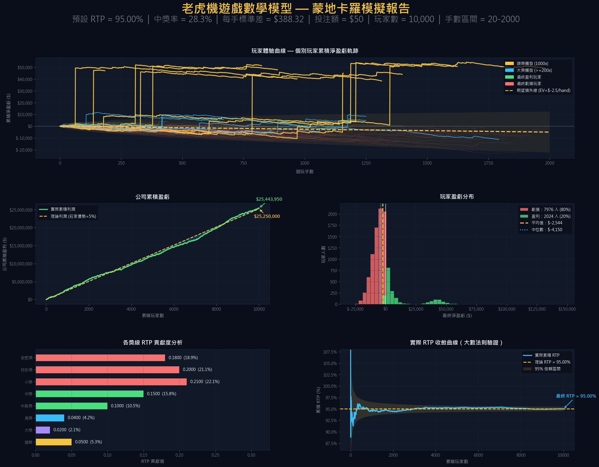

# Game Probability Model — 遊戲機率數學模型

以數學推導搭配蒙地卡羅模擬（Monte Carlo simulation）設計遊戲機率模型的實驗集。
每個模型都走過同一套流程：**賠付表設計 → 理論指標推導 → 大規模模擬驗證**，確認數學上的設計在實際遊玩中真的成立。

**文章介紹：** [Slot Game Probability Model](https://ping-hsun-chiang.github.io/personal-website/posts/game_probability_model/)




---

## 要解決的問題

遊戲機率模型要同時滿足兩個互相拉扯的目標：

- **對營運方：** 長期回報率（RTP, Return to Player）必須精準落在目標值，公司利潤才可預期。
- **對玩家：** 要有足夠的中獎頻率與偶發大獎，遊戲才好玩；但波動太大又會讓營運風險失控。

只看數學公式無法回答「真實玩家實際會經歷什麼」，例如多少人最後是贏的、公司的利潤多快收斂到理論值。
因此每個模型都用模擬重現上萬名玩家的遊玩過程，再與理論值逐項比對。

## 模型列表

| 模型 | 目標 | 關鍵指標 | 程式碼 |
| --- | --- | --- | --- |
| 🎰 Slot Game | RTP 95%、高波動性老虎機 | Volatility σ ≈ 7.77 ｜ Hit Frequency 28.3% ｜ 頭獎 1,000× | [RTP_95.ipynb](RTP_95.ipynb) |

---

## Slot Game — RTP 95% 數學模型

### 賠付表設計（Paytable）

每次下注 $50，結果依下表機率抽出一個獎級，派彩 = 下注額 × 倍數。

| 獎級 | 倍數 | 機率 | 約幾手出現一次 | RTP 貢獻 | 占總 RTP |
| --- | ---: | ---: | ---: | ---: | ---: |
| 頭獎 | 1,000× | 0.005% | 20,000 | 0.050 | 5.3% |
| 大獎 | 200× | 0.010% | 10,000 | 0.020 | 2.1% |
| 高獎 | 50× | 0.080% | 1,250 | 0.040 | 4.2% |
| 中高獎 | 20× | 0.500% | 200 | 0.100 | 10.5% |
| 中獎 | 10× | 1.500% | 67 | 0.150 | 15.8% |
| 小獎 | 5× | 4.200% | 24 | 0.210 | 22.1% |
| 迷你獎 | 2× | 10.000% | 10 | 0.200 | 21.1% |
| 安慰獎 | 1.5× | 12.000% | 8 | 0.180 | 18.9% |
| 未中獎 | 0× | 71.705% | — | 0 | 0% |

設計思路：約 **62% 的 RTP 來自 5× 以下的小獎**，讓玩家頻繁獲得回饋；高倍數獎項機率極低，
但只占 RTP 的 12%，作為吸引力來源，同時把波動控制在可預期的範圍。

### 理論指標推導

令 $m_i$ 為倍數、$p_i$ 為機率：

| 指標 | 公式 | 結果 |
| --- | --- | --- |
| RTP（期望回報） | $E[M] = \sum p_i m_i$ | **0.9500** |
| Variance（變異數） | $E[M^2] - E[M]^2$ | 60.32 |
| Volatility（波動度） | $\sigma = \sqrt{Var}$ | **7.77**（每手標準差 $388） |
| Hit Frequency（中獎率） | $\sum_{m_i > 0} p_i$ | **28.3%** |
| 莊家優勢（House edge） | $1 - RTP$ | 5%（每手期望損失 $2.5） |

### 蒙地卡羅模擬

- **規模：** 10,000 位玩家，每人隨機遊玩 20～2,000 手，共約 **1,018 萬次 spin**。
- **可重現：** 固定 `np.random.seed(42)`，每次執行結果相同。
- **向量化：** 每位玩家的所有 spin 以 `np.random.choice` 一次抽出，再用 `np.cumsum` 算出累積盈虧軌跡。

報告共 5 張圖，各自回答一個問題：

| 圖表 | 回答的問題 |
| --- | --- |
| 玩家體驗曲線 | 個別玩家的盈虧軌跡長什麼樣？大獎如何改變一個人的結果？（搭配期望值線與 ±1σ 理論區間） |
| 公司累積盈虧 | 公司利潤是否沿著理論值成長？ |
| 玩家盈虧分布 | 最後有多少人贏、多少人輸？ |
| 各獎級 RTP 貢獻度 | 回報主要來自哪些獎級？ |
| 實際 RTP 收斂曲線 | 實際 RTP 多快收斂到 95%？是否落在 95% 信賴區間內？ |

### 驗證結果

| 指標 | 理論值 | 模擬結果 |
| --- | --- | --- |
| RTP | 95.000% | **95.002%** |
| 公司總盈利 | $25,454,615（實際手數 × $50 × 5%） | **$25,443,950**（誤差 0.04%） |
| 頭獎觸發 | 每人平均約 1,018 手，期望約 5% 玩家觸發 | 491 / 10,000 人（4.9%） |

玩家端的實際體驗：

- **盈利玩家比例：** 20.2%。即使 RTP 有 95%，**每 5 個玩家中約有 4 個最後是虧損的**。
- **平均 vs 中位數：** 平均淨盈虧 −$2,544，中位數 −$4,150。少數頭獎玩家把平均拉高，
  一般玩家的實際經驗比平均值差，這是高波動性遊戲的典型右偏分布。
- **雙峰分布：** 盈虧分布在 +$50,000 附近出現第二個峰，正好對應頭獎（1,000× × $50）的玩家群。
- **極值：** 最大盈利 +$146,900，最大虧損 −$28,900。

### 已知限制

- 「公司累積盈虧」圖的理論線以**平均手數**（1,010 手）計算，得到 $25,250,000；以實際總手數計算的理論值為 $25,454,615，
  與模擬結果更接近。兩者差異來自隨機抽到的手數，而不是模型偏差。
- 目前的模型是單一機率表（每手獨立），尚未模擬實際轉輪（reel strip）與連線（payline）結構。

## 執行方式

**需要：** Python 3.10 以上。

```bash
pip install numpy matplotlib jupyter
jupyter notebook RTP_95.ipynb
```

圖表使用中文字型（Microsoft JhengHei／Microsoft YaHei／SimHei），在 Windows 上可直接顯示；
其他系統需安裝其中一種字型。

## 專案結構

```
RTP_95.ipynb             Slot Game 模型：參數設定、理論指標、蒙地卡羅模擬、視覺化報告
docs/
  images/                README 使用的圖表
```

## 未來規劃

- 加入轉輪（reel strip）與連線（payline）結構，從符號配置反推賠付機率
- 免費遊戲（Free Spins）、倍數加乘等特殊機制對 RTP 與波動度的影響
- 其他遊戲類型的機率模型（例如百家樂、彩票）
